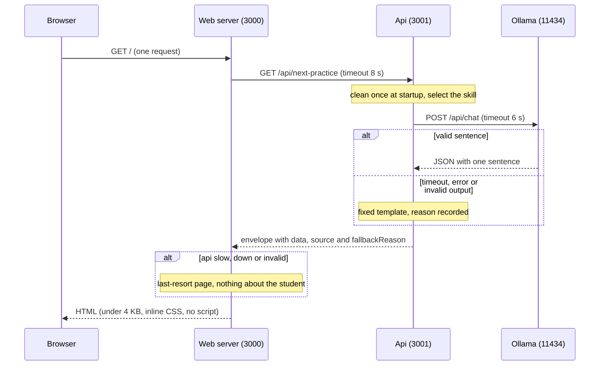
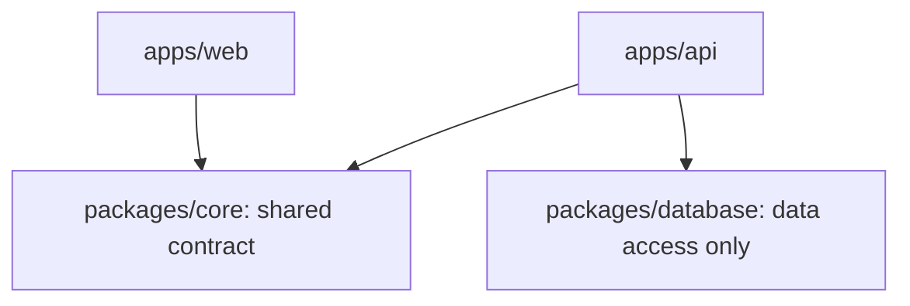

# Practice Coach

"What should I practice next, and why?" for one student, built from a raw `attempts.json` export. A student opens one screen, sees their first name, the skill that needs the most work, a sentence with their own numbers, and one short encouraging sentence written by a language model that is checked by rules before the student reads it. If the model is slow, down or wrong, the student still gets a complete, correct message.

This is a take-home exercise. I made choices under a time budget, and each one is explained below so I can defend it.

## Contents

1. [Run it](#1-run-it)
2. [Architecture](#2-architecture)
3. [How the next skill is selected](#3-how-the-next-skill-is-selected)
4. [Making the LLM reliable](#4-making-the-llm-reliable)
5. [The phone and the 3G connection](#5-the-phone-and-the-3g-connection)
6. [Cost at 100,000 requests per day](#6-cost-at-100000-requests-per-day)
7. [Assumptions](#7-assumptions)
8. [The student switcher is for the demo only](#8-the-student-switcher-is-for-the-demo-only)
9. [What I did not build, and what I would do next week](#9-what-i-did-not-build-and-what-i-would-do-next-week)
10. [Git workflow](#10-git-workflow)

## 1. Run it

You need Node 22.13 or newer and git, and nothing else has to be configured. Node 25 is the one version to avoid, because vitest 5 does not support it. The pnpm version is pinned in `package.json`, and Corepack, which ships with Node 22 and 24, makes it available.

```bash
git clone https://github.com/crahantan/take-home-exercise-SubjectAI.git
cd take-home-exercise-SubjectAI
corepack enable            # makes the pnpm version pinned in package.json available
pnpm install
pnpm dev                   # api on http://localhost:3001, web on http://localhost:3000
```

If `corepack enable` is not available (Node 25 and later no longer include Corepack) or needs administrator rights on your machine, `npm install -g pnpm@11.12.0` installs the pinned version directly. Then open http://localhost:3000.

The model is optional. To get the sentence written by a model, install [Ollama](https://ollama.com) and pull a small one before or after starting the project:

```bash
ollama pull qwen2.5:3b
```

Every environment variable has a default, so `pnpm dev` works without setting anything. The apps read variables from the process environment and there is no `.env` loader (`.env.example` documents them), so to change one, set it in the shell, for example `LLM_PROVIDER=none pnpm dev`. Without Ollama the app still works: the encouraging sentence comes from a fixed template and the response says why (`provider_error`). To skip the model on purpose, set `LLM_PROVIDER=none`.

| Variable | Default | Meaning |
| --- | --- | --- |
| `PORT` | api 3001, web 3000 | Port of each server |
| `HOST`, `BASE_API` | `localhost`, `/api` | Where the api listens |
| `API_URL` | `http://localhost:3001` | Where the web server finds the api |
| `LLM_PROVIDER` | `ollama` | `ollama` or `none` (any other value fails at startup) |
| `OLLAMA_URL`, `OLLAMA_MODEL` | `http://localhost:11434`, `qwen2.5:3b` | The local model |
| `LLM_TIMEOUT_MS` | `6000` | How long the api waits for the model |
| `WEB_API_TIMEOUT_MS` | `8000` | How long the web server waits for the api. Keep it longer than `LLM_TIMEOUT_MS` |
| `DEMO_STUDENT_SWITCHER` | `on` | Demo aid, see [section 8](#8-the-student-switcher-is-for-the-demo-only) |
| `DEFAULT_STUDENT_ID` | `stu_1041` | The student the page shows |

`PORT` is shared by both apps, so setting it in the shell makes `pnpm dev` start both on the same port and they collide. Leave it unset, or start one app at a time.

The api on its own:

```bash
curl "http://localhost:3001/api/next-practice?student_id=stu_1041"
```

```json
{
  "success": true,
  "message": "Next practice skill selected",
  "data": {
    "studentId": "stu_1041",
    "firstName": "Ana",
    "skillId": "lin_eq_1",
    "skillName": "Solving one-step linear equations",
    "evidence": {
      "attempts": 7,
      "correct": 2,
      "hints": 4,
      "recentResults": [false, false, false, true, false],
      "daysSinceLastAttempt": 0,
      "thinEvidence": false
    },
    "explanation": "You got 2 of 7 tries right on Solving one-step linear equations, and you used a hint on 4 of them. Take your time and work through each step carefully.",
    "source": "llm",
    "fallbackReason": null
  }
}
```

Checks: `pnpm typecheck`, `pnpm lint`, `pnpm format:check` and `pnpm test` (11 tests: 9 in the api, 2 in the web). There is no turbo: plain pnpm workspaces are enough for this size.

## 2. Architecture

The browser talks only to the web server. The web server is the only caller of the api, and the api is the only caller of the model. Because the browser never calls the api, there is no CORS configuration at all.



The repository is a pnpm monorepo. Internal packages are consumed as TypeScript source, so there is no build step.



```text
apps/api/src
  app.ts                      bootstrap
  lib/                        all business logic, as pure functions with their tests
    cleaning.ts               raw export -> clean attempts + CleaningReport
    selection.ts              clean attempts -> chosen skill + evidence
    explanation.ts            evidence sentence, fallback templates, validation of model output
    get-explanation.ts        calls the provider with a timeout, validates, falls back, never throws
    llm/                      provider implementations (ollama.ts), index.ts, prompts/motivation.v1.txt
    app-error.ts, logger.ts   the error class and the one-JSON-line logger
  middleware/                 validate-request, error handler, not-found handler
  modules/next-practice/      routes, controllers, services (orchestration only)
apps/web/src
  server.ts                   one route, one log line per request
  api/client.ts               the only place that fetches; validates the response with the core schema
  lib/                        config, student resolution, demo students, styles, last-resort text, log, escape-html
  views/                      layout, practice page, fallback page and demo switcher: typed functions that return HTML strings
packages/core                 zod schemas, types, ResponseUtil, the ExplanationProvider contract
packages/database             loadRawExport(): unknown, and data/attempts.json (never edited by hand)
```

**Why `core` and `database` are separate packages.** I split them so that, if the system has to scale, each can become an independent project and the security improves. `core` is only the contract (schemas, types, the response envelope and the provider interface), with no business logic, so it can be versioned and shared by the web and the api without sharing code that does work. `database` only reads data and returns `unknown`, and the api validates everything it gets, so replacing the JSON file with a real database service changes one package and nothing else. As an independent project it would have its own credentials and its own network zone, only the api could reach it and the web server never could, so a compromise of the page-rendering tier would not expose the data. That is least privilege and a smaller blast radius. The cost is that extracting them needs a build and publish step, which this exercise does not have on purpose.

**Conventions.** The api follows the layered module pattern of SWGAAF (schemas, routes, controllers, services), recorded in `.claude/module-pattern.md`. SWGAAF is my own previous project, a web system for the administrative management of financial advisors (Sistema Web de Gestión Administrativa para Asesores Financieros). If its name appears in `CLAUDE.md`, in `.claude/module-pattern.md` or in the prompts, that is what it refers to. The pattern was adapted from one module of that project, and everything that this exercise forbids (authentication, permissions, database, audits) was removed. Every response uses one envelope: success `{ success: true, message?, data }` and error `{ success: false, message, data: null, error }`. Unexpected errors return a generic 500 message and the real error goes only to the log. Request schemas are strict zod objects. TypeScript is strict, with no `any` outside one justified comment.

## 3. How the next skill is selected

The rule is a pure, deterministic function in `apps/api/src/lib/selection.ts`. For each skill the student has tried, it computes a smoothed accuracy and picks the lowest:

```text
score = (correct + 1) / (attempts + 2)
```

The smoothing adds one imaginary right answer and one imaginary wrong answer to every skill. That handles thin evidence. A skill with one try is neither ignored nor picked by chance: with a single wrong try a raw accuracy of 0 % would beat a skill the student failed five times out of seven, but the smoothed score of a single wrong try is 0.33, the same as a skill with 2 right out of 7, and that tie goes to the skill with more attempts. With a lot of data the score is close to the real accuracy. A skill with fewer than 3 attempts is also flagged (`thinEvidence`), and the sentence then says "You have only tried X 1 time so far, so this is an early look" instead of claiming a pattern.

Ties are broken by more attempts first, because that skill is better known, then by skill id, so the answer never changes between runs. Skills the student never tried are never candidates: there is no data about them and I do not invent any.

On the exported data:

| Student | Chosen skill | Attempts | Right | Hints | Score |
| --- | --- | --- | --- | --- | --- |
| Ana (stu_1041) | Solving one-step linear equations | 7 | 2 | 4 | 0.33 |
| Beto (stu_2277) | Multi-step word problems | 5 | 0 | 2 | 0.14 |
| Citlali (stu_3390) | Ratios and unit rates | 7 | 3 | 3 | 0.44 |

Citlali has a single attempt in the word problems, answered right. Its score is 0.67, so it neither wins nor is dropped.

What the rule does not do, on purpose: hints, response times and recency do not change the choice. Hints and recency are shown as evidence ("See how you did"). Time is cleaned and reported but not used, so a later feature does not inherit bad times. The honest weakness is that a right answer given with a hint counts as right, which flatters a skill the student only solved with help. Counting hinted answers as half would be the first change I would test, but I did not have a way to check it against real learning outcomes, so I kept the simple rule. Recency is measured against the student's latest attempt, never today's date, so the output does not change depending on the day it runs.

## 4. Making the LLM reliable

**The model never writes the numbers.** The message has two sentences. Code writes the first from the evidence ("You got 2 of 7 tries right on ..., and you used a hint on 4 of them"), so everything the student reads about their own data is correct even when the model fails. The model writes only the second: one short, encouraging sentence. The model receives the skill name and whether the evidence is thin. It never receives numbers or the student's name. I chose this after testing models on my machine (an AMD Ryzen 7 5700G, CPU only): `qwen2.5:3b` runs at about 22 tokens per second but ignores length instructions; `qwen2.5:7b` runs at about 9.7 tokens per second (about 4.8 s warm and 10.2 s cold) and follows length but ignores the data, producing the same generic sentences. A hosted model through the Claude CLI took 5.5 to 8.3 s with a JSON schema. I had no API key, so Ollama is the provider behind an interface, and the CLI was only a development experiment and is not part of the product.

**The pipeline.** `getExplanation` in `apps/api/src/lib/get-explanation.ts` calls the provider with an `AbortSignal` timeout (6 s by default). The provider returns `unknown`, and nothing it returns is trusted. The result is parsed with a strict zod schema and then checked by rules. Any failure uses a fixed template. The function never throws.

| Rule | What it rejects |
| --- | --- |
| `shape` | Anything that is not `{ "message": string }` |
| `length` | Empty, or longer than 100 characters |
| `sentence_count` | More or fewer than exactly one sentence |
| `digits` | Any digit. Every number comes from the evidence sentence |
| `markup` | `< > { } [ ]`, backticks, links |
| `praise` | Words such as "great" or "perfect". The chosen skill is by definition the student's weakest, so praise about it is never supported by the data |

Every response says where its text came from: `source` is `llm` or `fallback`, and `fallbackReason` is `timeout`, `provider_error`, `invalid_output` or `disabled`. I tested each path with real requests: a dead Ollama address gives `provider_error`, a 1 ms timeout gives `timeout`, `LLM_PROVIDER=none` gives `disabled`, and with the model running the same request gives `llm`. The fake-provider tests cover all four reasons and check that the evidence sentence is identical in every case.

**How production would show the model failing.** The api writes one structured JSON line per request:

```json
{"event":"next_practice_explained","studentId":"stu_1041","skillId":"lin_eq_1","provider":"ollama","model":"qwen2.5:3b","promptVersion":"v1","latencyMs":1221,"source":"llm","fallbackReason":null,"invalidRule":null,"thinEvidence":false}
```

The web server writes its own line (`page_rendered`) with the outcome, the api latency, the source and the fallback reason it received. From these two lines a dashboard can show the fallback rate by reason, the latency percentiles, and the invalid-output rate by rule. A rising `timeout` rate means the model is too slow or cold, rising `provider_error` means it is down, and rising `invalid_output` with one `invalidRule` means the prompt or the model changed. I would alert on the fallback rate over a window. A threshold such as 20 % over 15 minutes is only an illustration; I would set it from a week of real data. The prompt is in version control, so you can read it, at `apps/api/src/lib/llm/prompts/motivation.v1.txt`. The version is in the file name and in every log line, so a change of behavior can be tied to a prompt change.

**What the rules do not catch.** They check form and safety, not truth. In my live test the model wrote "start with the simplest side first", a piece of math advice that the data does not support. It is harmless, but validation cannot prove it right. This is the reason the numbers are not left to the model, and a next step would be an offline evaluation of sample outputs.

## 5. The phone and the 3G connection

The page is one server-rendered HTML response with inline CSS, a system font, no JavaScript, no images and no external requests. The practice page is about 3.8 KB and the fallback page about 2.9 KB; the CSS is 2.1 KB of that. These are measured. The common rule of thumb is that the first TCP round trips carry about 14 KB, so the whole page arrives in the first round trip of data with room to spare.

My estimate of the network cost on a slow 3G profile (about 400 kbit/s and 400 ms of latency) is about 1.2 to 1.6 s for connection setup and the request, plus about 80 ms to move 3.8 KB. I have not measured it on a real device. The part that dominates is not the network: the page waits for the api, and the api waits for the model. With the model warm the api answers in about 1 s (0.95 to 1.2 s measured); on a cold start it took 4.8 s, and the worst case is the 6 s model timeout followed by the template, inside the 8 s the web server waits. So the slowest realistic page is about 6 to 8 s plus the network, and the fast one is about 2 to 3 s. The fixes are in section 9: cache the model sentence and warm the model at startup. If the api is down the page does not wait: the web server answers in milliseconds with the last-resort page.

Other choices for a low-end Android phone: a viewport meta tag, text of at least 16 px, tap targets of at least 44 px, contrast of at least 4.5:1, and symbols plus color (✓ and ✗) so color is never the only signal. The "See how you did" block is a native `<details>`, so it opens without JavaScript. Every dynamic string is HTML-escaped, especially the model text, and a test feeds hostile strings through both pages. Compression belongs to the reverse proxy in front of the server; I did not add a dependency for it.

The screen gives the student a way to start: a large "Start practicing" button right under the suggestion. The practice questions themselves are not part of this exercise and a second screen is not allowed, so the button opens a short note on the same page, built with the CSS `:target` selector and no JavaScript, that says so honestly. In the real app the button would be a link to the platform's existing practice for that skill, and the response already carries the `skillId` for it. The other interaction is a native `<details>` that opens the numbers behind the suggestion.

## 6. Cost at 100,000 requests per day

That is about 1.2 requests per second on average. One recommendation costs one model call: about USD 0.0006 to 0.0011 with a hosted model at the sizes I measured, and nothing per call with a self-hosted model beyond the machine time, about 1 s of CPU. In this version nothing is cached, so the figures below are the worst case. The rest of the api is negligible: the export is cleaned once at startup and selection is a loop over a few dozen attempts.

| Option | Basis | Estimate |
| --- | --- | --- |
| Hosted model | The Claude CLI reported about USD 0.0006 to 0.0011 per call in my tests (a list-price equivalent, measured, not billed) | About USD 60 to 110 per day, USD 1,800 to 3,300 per month |
| Self-hosted Ollama | About 1 s per warm call on one desktop CPU, so one machine handles about 1 call per second. I assume peaks of 5 times the average, so about 6 machines | Instances times hourly price. At an assumed USD 0.30 to 0.40 per hour for an 8-vCPU instance (an assumption, to check with the provider), about USD 1,300 to 1,700 per month |

**A cache is necessary to run this at 100,000 requests per day, and I would not launch without one.** The biggest lever is not the choice of provider. Because of the hybrid design, the model input depends only on the skill name and on whether the evidence is thin. In this export that is 6 skills times 2, so 12 distinct prompts. A cache with a few stored sentences per key would turn 100,000 daily model calls into a handful, and the cost would drop to one small instance. With a single api instance an in-process map would be enough, but with several instances each one would keep its own copy and warm up on its own, so a shared cache such as Redis is the right choice: one entry per key, the prompt version inside the key, and a time to live so a new prompt takes effect. I did not build it, to stay inside the time budget and because I did not want to add a dependency without discussing it. It is the first item of the next-week list.

The behavior with the cache must be analyzed and not assumed: hit rate, latency of a miss, load on the model server and memory, measured under a realistic load test. If that analysis shows a bottleneck, the next piece of work is a scaling study. Scaling vertically means a bigger machine or a GPU for the model. Scaling horizontally means more api replicas behind a load balancer, which works because the api keeps no state once the cache is shared, plus more model replicas. Which one is right depends on where the measurements point, and I would decide with those numbers. The trade-off of the cache is less variety in the sentence, which I think is acceptable for one short line.

## 7. Assumptions

`attempts.json` stays raw and is never edited. `apps/api/src/lib/cleaning.ts` turns it into clean attempts plus a `CleaningReport` with one count per rule, written to the log at startup. On the exported file there are 123 raw rows and 122 clean ones.

| Rule | What it does | Rows in the export |
| --- | --- | --- |
| `malformed_row` | Drops a row that fails the schema or has an invalid date | 0 |
| `unknown_skill`, `unknown_student` | Drops a row whose id is not in the export's lists | 0 and 0 |
| `duplicate_attempt_id` | Keeps the first row and drops later rows with the same `attempt_id` | 1 (`att_5112`) |
| `missing_seconds` | Keeps the attempt; the time is unknown, never zero | 2 (`att_5046`, `att_5088`) |
| `extreme_seconds` | Keeps the attempt for correctness and hints; time below 10 s or above 600 s becomes unknown | 3 (`att_5097`, `att_5110`, `att_5063`) |
| `after_export` | Keeps the attempt and flags it; the date is not changed | 3 (`att_5042`, `att_5055`, `att_5089`) |

Other assumptions, each of which I would confirm with the data owner:

- The same student seeing the same item on a different date is a legitimate retry and is kept. Only a repeated `attempt_id` is a duplicate.
- The 10 s and 600 s limits are my judgment, not facts from the data. They catch the two 6 s answers and the 4,211 s outlier and leave every other time alone.
- Attempts dated after `exported_at` are kept because the export may have been cut a little before it was written. I flag them instead of deciding.
- Timestamps must use the `Z` form. A row with another offset counts as malformed. The export only uses `Z`.
- A student id that looks valid but is not in the export gets a 404 from the api, and the student sees the last-resort page. A student in the export with no attempts gets a 404 with its own message. Neither case occurs in the data, and the second is not tested.
- The web server answers 200 with the last-resort page when the api fails and writes the reason to the log. I chose 200 so intermediaries do not replace the page with their own error.
- The web server adds `/api` to `API_URL` itself, so a change of `BASE_API` in the api needs one matching change in the web server.
- The demo list of students in the web server copies the three students of the export (see the next section).
- The two sentences are not localized. All student-facing text is in English, and localization is a next step.

## 8. The student switcher is for the demo only

The screen has a small "Demo only: view as" form so that a reviewer can see the three students without editing anything. I added it only to present the exercise, and it is not part of the design I would ship. In a real system a student opens the app signed in to their own account, and the student id comes from the server-side session, never from a query string or a selector. If a page lets the browser choose the id, anyone can read another student's data by changing it, which is an insecure direct object reference (IDOR).

So the switcher sits behind `DEMO_STUDENT_SWITCHER`, which is `on` by default only so that `pnpm dev` works for the reviewers. With the flag `off`, the web server ignores `student_id` in the URL completely and always uses `DEFAULT_STUDENT_ID`, which stands in for the signed-in account, and the form is not rendered. You can see the difference live: with the flag off, typing another id in the address bar changes nothing. `.env.example` says the flag must be `off` in any real deployment, and the server prints a line at startup saying whether it is on.

The list of students behind the form lives in `apps/web/src/lib/demo-students.ts`, copied from the export because the api has no endpoint that lists students, and I did not want to add one only for a demo. It is duplicated data, and it goes away with the switcher.

One more limit, stated plainly: the api itself takes `student_id` as a query parameter, as the exercise requires, so it has the same exposure. In production the web server would authenticate to the api as a service, and the api would check that the caller may read that student. Authentication was out of scope, so I did not build it. I mention it so the gap is a decision and not an oversight.

## 9. What I did not build, and what I would do next week

Left out on purpose, because the brief forbids it or the time budget does not allow it: authentication, a database (the app reads the JSON file), admin or teacher views, more than one screen, Docker, CI, cloud configuration, a component library and exhaustive tests. I wrote 11 tests, on the logic that deserves them: the cleaning rules, the selection, the validation of model output, the failure path of the pipeline, HTML escaping and the api client. The practice itself, the questions a student answers, is also out of scope, so the start button is a stub, as described in section 5.

Next week, in this order:

1. Add a shared cache (Redis) for the model sentence, keyed by skill, thin-evidence flag and prompt version, and warm the model at startup with `keep_alive`, so the cold start of 4.8 s stops eating the timeout. Then run a load test, analyze the hit rate, the latency of a miss and the load on the model server, and decide between vertical and horizontal scaling from those numbers.
2. Replace the in-page note behind the start button with a link to the platform's existing practice for the chosen skill, which the response already identifies with its `skillId`.
3. Take the student id from a signed-in session, authorize it in the api and remove the switcher.
4. Dashboards and alerts on the two log lines, with thresholds set from real data, and an offline evaluation of model outputs.
5. Test counting a hinted right answer as half, and use response time once there is evidence it helps.
6. Add CI with the four checks, and split `core` and `database` into independent projects when the data moves to a real database.
7. Localize the student-facing text (Spanish first), and measure the page on a real low-end phone over a real 3G connection.

## 10. Git workflow

I worked in several branches (for example `feat/backend/data-cleaning`) and each one has more than one commit, on purpose: the commits show how each piece was built, in an order where each depends only on the ones before it (contract, then logic, then tests, then documentation). Each branch was merged through a pull request into `develop`, with merge commits so the history keeps the branch structure, and `main` receives the integrated result. I do not know the commit guidelines your team uses, so I used a common format: a type and scope prefix (`feat(api):`, `test(web):`, `docs:`) and a short imperative subject in English, with a body when the reason is not obvious. If your team prefers one commit per branch or squash on merge, that is a change at merge time and does not change how I work in a branch.
